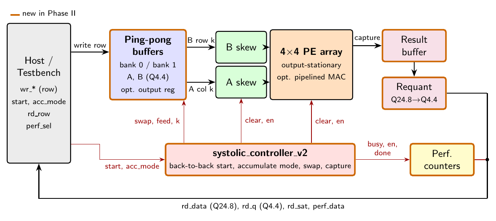
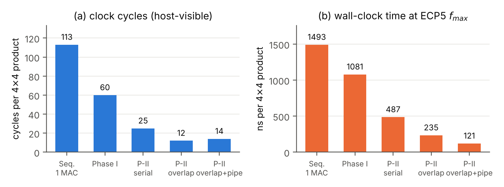

# Systolic Array Matrix Multiplication Accelerator

**CSA-222 Modern Computer Architecture: group project (Project 12)**
A parameterised **N×N output-stationary systolic array** for signed fixed-point (Q4.4) matrix multiplication, written in synthesizable **Verilog-2005**. It is verified with **Icarus Verilog** against a bit-exact Python golden model, and synthesised and placed-and-routed with open-source FPGA tools. No hardware board is required.

| | |
|---|---|
| **Final report (Phase II)** | [`report/final_report.pdf`](report/final_report.pdf) (IEEE format, LaTeX source alongside) |
| **Phase I report** | [`report/phase1_report.pdf`](report/phase1_report.pdf) |
| **Prototype video (Phase I)** | **[Watch on Google Drive](https://drive.google.com/file/d/1_Fuetn23N6ReVL-TJW9B5vXp2K5eXfok/view?usp=sharing)** |
| **Team** | Harshvardhan Gupta (2401010185) · Harsha Gonela (2401010181) · Abhijeet Dey (2401010014) · Saumya Kumar (2401010432) · Shivansh Upadhyay (2401020109) |



---

## Headline results (4×4 array)

| Design | cycles / product | Fmax (ECP5, post-route) | ns / product | speed-up vs 1 MAC |
|---|---|---|---|---|
| Sequential baseline (1 MAC) | 113 | 75.7 MHz | 1493 | 1.0× |
| Phase I systolic | 60 | 55.5 MHz | 1081 | 1.4× |
| Phase II, overlapped | 12.06 | 51.3 MHz | 235 | 6.4× |
| **Phase II, overlapped + pipelined** | **14.06** | **116.4 MHz** | **121** | **12.4×** |

- **Verification:** more than 85,000 element checks pass, including a 1,000-matrix random regression, all four pipeline configurations, N = 2…16, tiled 8×8 and 12×12 GEMMs, and the weight-stationary array.
- **Analytical model** (`model/perf_model.py`): predicts every measured latency exactly. The latency is 3N cycles, and the PE utilisation is 1/3.
- **Amdahl's law in hardware:** Phase I was only 1.4× faster than the baseline because 48 of its 60 cycles were I/O. Double buffering hides that I/O.
- **Numerics:** RMSE vs float64 is 0.035 after requantising to Q4.4. Saturation affects 0.3% of outputs, and only for ±2-range inputs.



## What is in Phase II

| Feature | Files |
|---|---|
| Ping-pong (double-buffered) operand buffers, row-wide host interface | `rtl/matrix_buffer_pp.v` |
| Controller v2: back-to-back starts, accumulate mode (tiling), bank swap, result capture | `rtl/systolic_controller_v2.v` |
| Result buffer + output requantisation Q24.8 → Q4.4 (round + saturate) | `rtl/systolic_top_v2.v`, `rtl/requant.v` |
| Hardware performance counters | `rtl/perf_counters.v` |
| Optional pipeline registers: `MUL_PIPE` (MAC), `BUF_REG` (buffer output) | `rtl/mac_unit.v`, `rtl/matrix_buffer_pp.v` |
| Sequential single-MAC baseline (N³ cycles) | `rtl/seq_matmul.v` |
| Weight-stationary streaming array (TPU-style), for comparison | `rtl/ws/` |
| Golden model, numerics study, performance model, result plots | `model/` |
| Yosys + nextpnr synthesis / P&R, Vivado script | `syn/` |

## Repository layout

```
rtl/                     synthesizable RTL (Phase I modules kept unchanged in behaviour)
  mac_unit.v pe.v systolic_array.v input_skew.v            datapath (MUL_PIPE option)
  matrix_buffer.v systolic_controller.v systolic_top.v      Phase I top
  matrix_buffer_pp.v systolic_controller_v2.v requant.v
  perf_counters.v systolic_top_v2.v                         Phase II top
  seq_matmul.v                                              sequential baseline
  ws/pe_ws.v ws/systolic_array_ws.v ws/ws_top.v             weight-stationary design
tb/                      10 self-checking testbenches
model/                   golden_model.py, numerics_analysis.py, perf_model.py,
                         plot_results.py, plot_wave_v2.py, plot_style.py
tests/vectors/           generated $readmemh vectors (directed, random, requant, WS, tiled)
sim/                     Makefile, run_all.sh, GTKWave presets (*.gtkw)
syn/                     synth_one.sh, run_all_synth.sh, collect_synth.py, vivado/
results/                 logs, CSV tables, figures, summary.md (all regenerable)
docs/                    figures, interview guides, commit plans, roadmap
report/                  Phase I and final IEEE reports (LaTeX + PDF)
```

## How to run

Requirements: Icarus Verilog (v12 or v13), Python 3. GTKWave is optional.
For plots: `pip install numpy matplotlib`. For synthesis: `yosys`, `nextpnr-ecp5`, `fpga-trellis`.

```bash
cd sim
make all            # every functional test (or ./run_all.sh without make)
```

Expected: 21 `RESULT:` lines, all passing. Individual targets:

| Target | What it runs |
|---|---|
| `make mac pe array top` | Phase I unit and system tests |
| `make requant` / `make macpipe` | requantiser, pipelined MAC |
| `make top2` | Phase II top: serial and overlapped, 4 pipeline configs |
| `make seq` / `make regress` | sequential baseline / 1000-test random regression |
| `make ws` / `make tiled` / `make sweep` | weight-stationary, tiled GEMM, N = 2…16 sweep |
| `make results` | all of the above + logs + CSV tables + figures |
| `make wave_top2` | GTKWave with the Phase II preset |

Synthesis (about 7 minutes):

```bash
cd syn
./run_all_synth.sh   # Yosys (Xilinx 7-series estimates) + nextpnr-ecp5 (post-route Fmax)
```

Vivado (optional): `syn/vivado/run_vivado_all.sh` gives Artix-7 utilisation and Fmax.

## References

Key sources: H. T. Kung, *Why systolic architectures?* (IEEE Computer, 1982); N. Jouppi et al., *In-datacenter performance analysis of a TPU* (ISCA 2017); V. Sze et al., *Efficient processing of DNNs* (Proc. IEEE, 2017). The full list is in the report.
